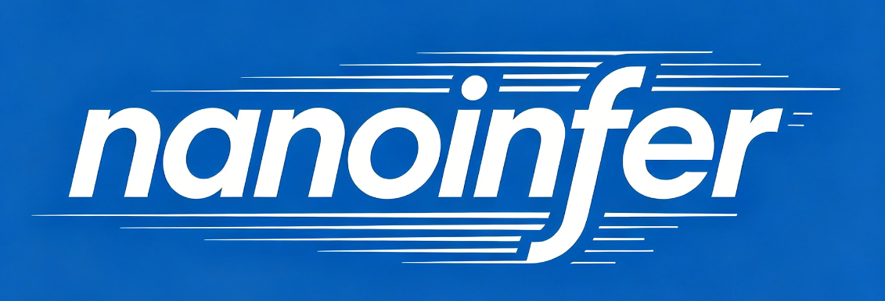
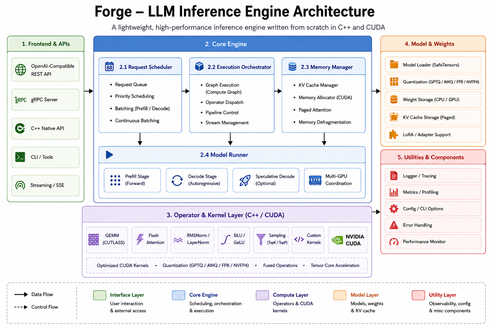
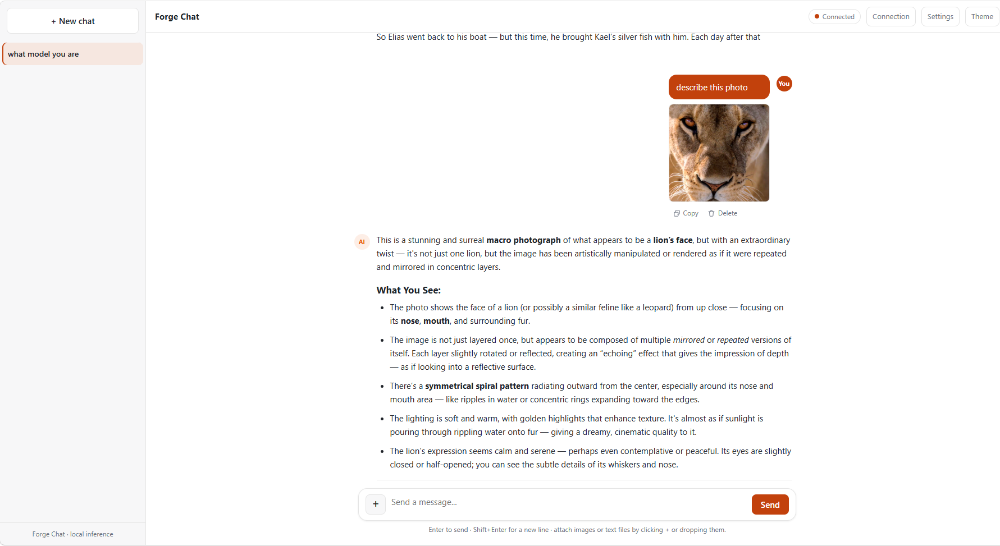
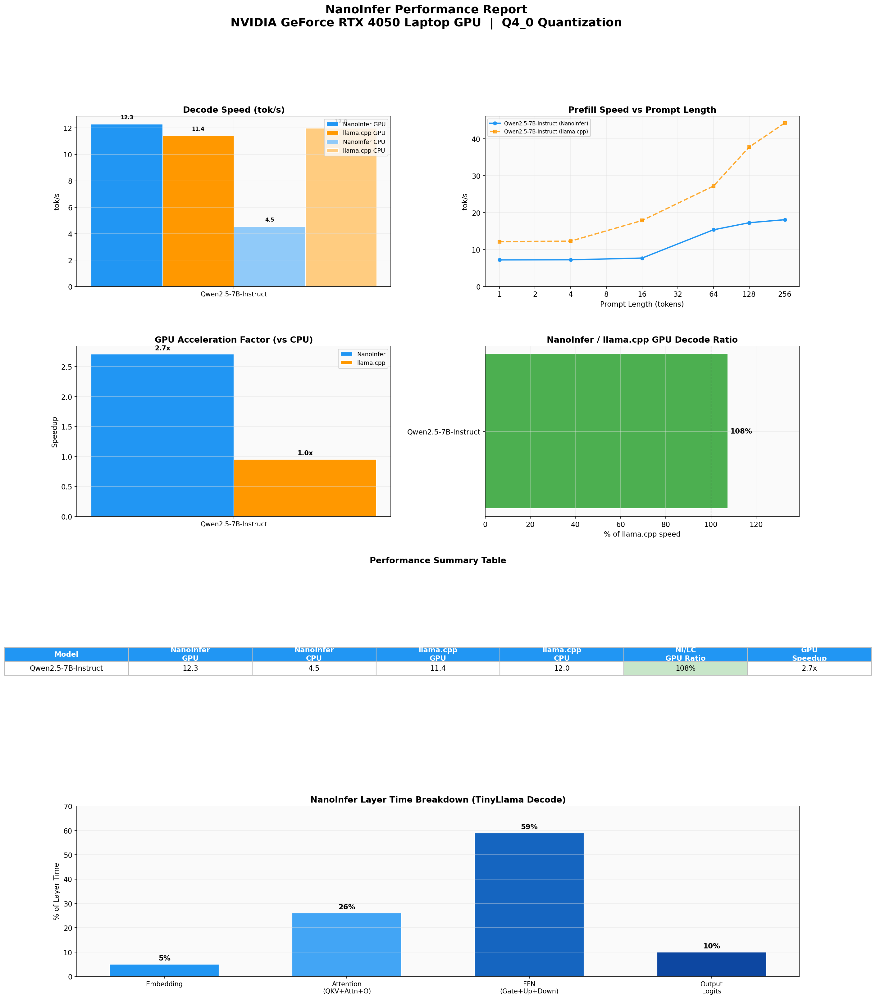

<p align="center">
  
</p>

<h1 align="center">Forge</h1>

<p align="center">
  <strong>轻量级 LLM 推理引擎</strong><br>
  纯 C++/CUDA · 极简依赖 · 自研 Kernel
</p>

<p align="center">
  <a href="README.md">English</a> | 中文
</p>

<p align="center">
  <a href="https://github.com/Cyxuan0311/Forge/stargazers">
    
  </a>
  <a href="https://github.com/Cyxuan0311/Forge/network/members">
    
  </a>
  <a href="https://github.com/Cyxuan0311/Forge/issues">
    
  </a>
  
</p>

<p align="center">
  
  
  
</p>


## 简介

**Forge** 是一个从零开始使用 **C++ 和 CUDA** 实现的轻量级 LLM 推理引擎。

它不依赖 PyTorch、TensorFlow 等重量级 ML Framework，专注于提供一套**极简、透明、高性能的推理栈**。

### 核心特性

* **纯 C++/CUDA** — 极少运行时依赖
* **自研 CUDA Kernel** — GEMM、GEMV、Flash Attention、RMSNorm、RoPE、Sampling 等
* **高性能 CPU 后端** — AVX2 + OpenMP
* **量化推理** — Q4_0、Q4_1、Q4_K、Q6_K、Q8_0
* **可选 BLAS** — cuBLAS / OpenBLAS
* **多模型架构** — LLaMA、DeepSeek、Qwen3.5、Qwen3-VL、Gemma4、MiniCPM-V


## 架构

Forge 将推理路径保持在一个紧凑的分层结构中，从用户接口一直到底层 CPU/GPU Kernel。

<p align="center">
  
</p>

```text
Model
  ↓
Inference Engine
  ↓
Operators
  ↓
CPU / CUDA Kernels
  ↓
Hardware
```

详细设计请参考[架构设计](docs/architecture_zh.md)。


## 演示

<p align="center">
  
</p>


## 快速开始

### 环境要求

* CMake ≥ 3.18
* C++17 编译器
* CUDA Toolkit ≥ 12.8（GPU 推理）
* Python 3 + NumPy（Python 示例）

### 编译

```bash
git clone https://github.com/Cyxuan0311/Forge.git
cd Forge

cmake -B build
cmake --build build -j
```

### CLI

```bash
# 交互式对话
./build/forge-cli -m model.gguf --stream

# 单次生成
./build/forge-cli \
    -m model.gguf \
    -p "你好，世界！" \
    -n 128
```

### Python

```bash
python examples/qwen_inference.py \
    --model-path model.gguf \
    --device cuda
```

详细的构建和使用说明请参考[文档](#文档)。


## 支持的模型

| 架构            | 代表模型                       | 结构                                       | 多模态 |
| ------------- | -------------------------- | ---------------------------------------- | --: |
| **LLaMA**     | TinyLlama、Qwen2.5、Qwen3-VL | GQA                                      |   ✅ |
| **DeepSeek**  | DeepSeek-V2/V3、DeepSeek-R1 | MLA                                      |   ❌ |
| **Qwen3.5**   | Qwen3.5-MoE                | Hybrid SSM + Gated Delta Net + Attention |   ❌ |
| **Gemma4**    | Gemma4                     | SWA + Full Attention + MoE               |   ❌ |
| **MiniCPM-V** | MiniCPM-V 4.6              | GQA                                      |   ✅ |

具体实现请参考[模型支持](docs/models_zh.md)。


## 性能

Forge 提供独立的 Benchmark Pipeline，位于 `report/`。

### Qwen2.5-7B-Instruct Q4_0

**RTX 4050 Laptop GPU**

<p align="center">
  
</p>

可以在自己的硬件上重新生成 Benchmark：

```bash
python -m report.runner
```

详细结果和测试方法见 `resource/reports/`。


## 文档

| 文档                                  | 内容        |
| ----------------------------------- | --------- |
| [构建指南](docs/build_zh.md)            | 编译与配置     |
| [依赖说明](docs/dependencies_zh.md)     | 环境与依赖     |
| [Python API](docs/python_api_zh.md) | Python 接口 |
| [CLI 使用](docs/cli_zh.md)            | 命令行推理     |
| [模型支持](docs/models_zh.md)           | 模型架构支持    |
| [架构设计](docs/architecture_zh.md)     | 内部架构与设计   |


## 贡献

欢迎提交 Issue、性能优化、新算子以及新的模型架构支持。

详见 [CONTRIBUTING.md](CONTRIBUTING.md)。


## License

[MIT License](LICENSE)
